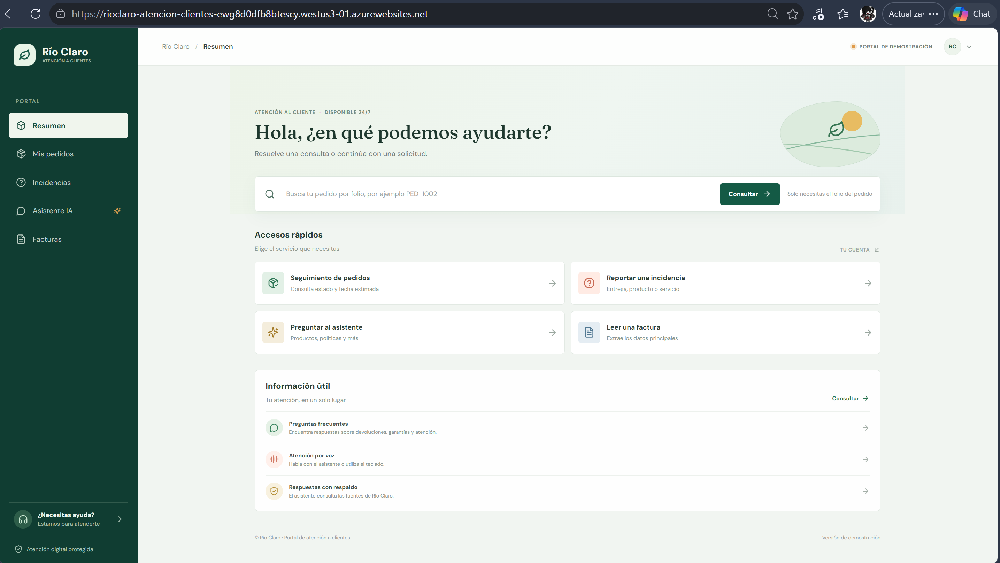
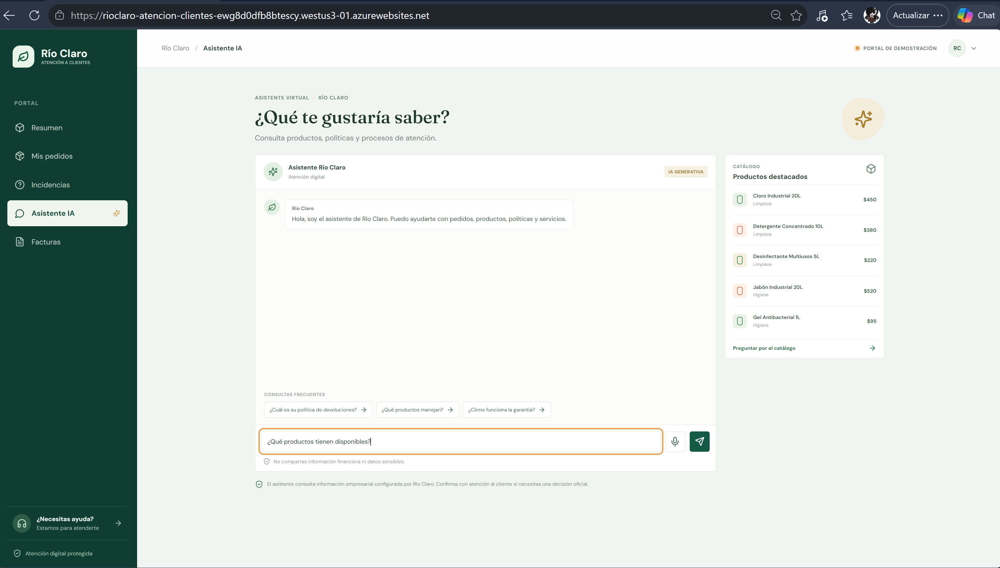
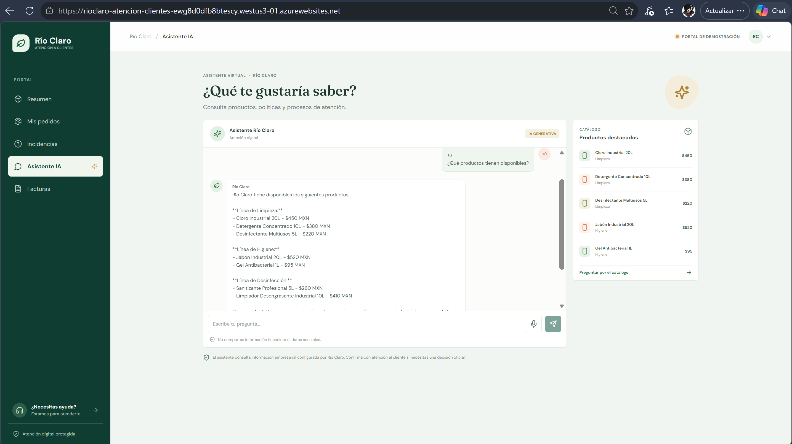
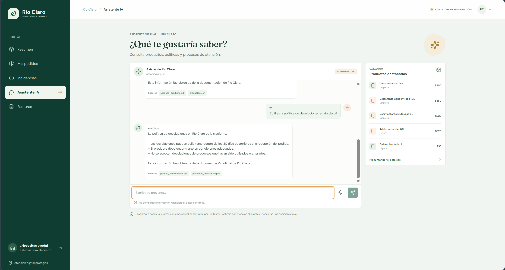
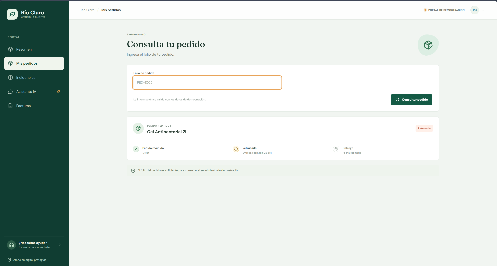
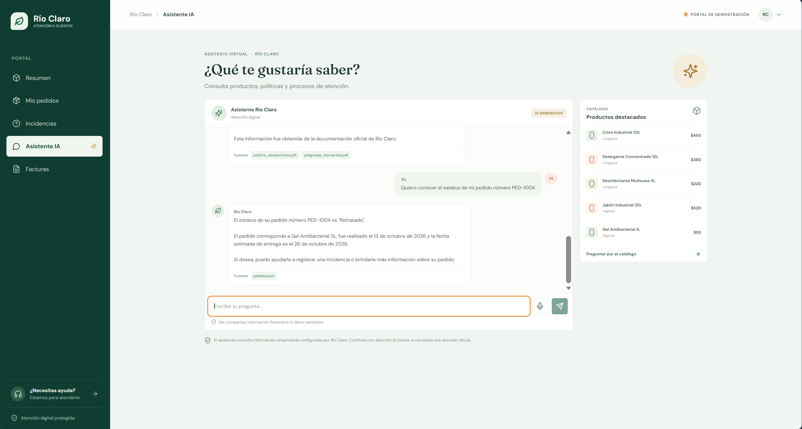
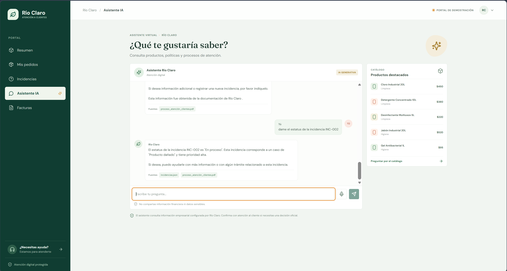

#   PROYECTO AI-901 RIO CLARO
## Asistente inteligente de atención a clientes y seguimiento de pedidos

### 1. Resúmen ejecutivo
Río Claro enfrenta retos relacionados con la atención y seguimiento a sus clientes debido a que la información se encuentra distribuida en diferentes sistemas, documentos y áreas operativas. Esto ocasiona demoras en la consulta del estado de pedidos, dificultades para atender incidencias y una alta dependencia del personal para responder preguntas frecuentes de los clientes.
Asimismo, los usuarios requieren acceso rápido a información sobre productos, políticas de devolución, procedimientos de atención y seguimiento de solicitudes sin depender exclusivamente de la disponibilidad de un agente humano.
La organización busca aprovechar los servicios de Inteligencia Artificial de Microsoft para mejorar la experiencia de atención al cliente, facilitar el acceso a la información y optimizar los procesos de servicio.

### 2. Objetivo de la solución
Desarrollar un asistente inteligente basado en Microsoft Azure AI Foundry capaz de brindar atención inicial a clientes mediante lenguaje natural, permitiendo:
- Consultar el estado de pedidos.
- Registrar incidencias y solicitudes de servicio.
- Resolver preguntas frecuentes. 
- Brindar información sobre productos y servicios. 
- Consultar información empresarial mediante IA Generativa.
- Procesar documentos comerciales utilizando capacidades de extracción automática de información.
- Ofrecer interacción por voz para mejorar la accesibilidad del sistema.

### 3. Alcance del proyecto
La solución contempla el desarrollo de un portal web accesible mediante navegador que integre servicios de Inteligencia Artificial de Microsoft Azure para apoyar los procesos de atención al cliente.

La solución incluirá:
#### Consulta de pedidos
Permitir a los usuarios consultar el estado de pedidos registrados dentro de una base de datos de prueba.

#### Registro de incidencias
Permitir a los clientes reportar problemas, quejas o solicitudes relacionadas con sus pedidos.

#### Asistente virtual inteligente
Responder preguntas utilizando información empresarial almacenada en documentos de referencia.

#### Extracción de información documental
Procesar facturas o documentos comerciales para extraer información relevante mediante Inteligencia Artificial.

#### Interacción por voz
Permitir consultas utilizando comandos de voz mediante servicios cognitivos de Azure.

### 4. Arquitectura de solución

                    CLIENTE

                       │
                       ▼

           Aplicación Web Río Claro

         ┌─────────────────┼─────────────────────────┐
         │                 │                         │
         ▼                 ▼                         ▼
Azure AI Foundry                  Azure Speech Service                     Document Intelligence

         │
         ▼

   Base Documental

   (PDF, FAQ, Políticas,
    Productos y Procesos)


### 5. Casos de uso
#### CU-01 Consulta de estado de pedido
##### Descripción
El cliente consulta el estado actual de un pedido utilizando un identificador único.
##### Ejemplo
Usuario: ¿Cuál es el estado de mi pedido PED-1008?
Sistema: El pedido PED-1008 se encuentra en tránsito y tiene una fecha estimada de entrega para el 24 de octubre.

#### CU-02 Registro de incidencias
##### Descripción
El cliente reporta una incidencia relacionada con productos o entregas.
##### Ejemplo
Usuario: Mi pedido llegó incompleto.
Sistema: Su incidencia ha sido registrada con el folio INC-2026-015.

#### CU-03 Consulta de políticas internas
##### Descripción
El cliente realiza preguntas relacionadas con procedimientos, garantías o devoluciones.
##### Ejemplo
Usuario: ¿Cuál es la política de devoluciones?
Sistema: De acuerdo con la política vigente, las devoluciones pueden realizarse dentro de los primeros 30 días posteriores a la entrega.

#### CU-04 Consulta de productos
##### Descripción
El cliente obtiene información sobre productos disponibles.
##### Ejemplo
Usuario: ¿Qué productos tienen disponibles para limpieza industrial?
Sistema: Actualmente contamos con limpiadores multiusos, desinfectantes industriales y detergentes especializados.

#### CU-05 Procesamiento de facturas
##### Descripción
El usuario carga una factura en formato PDF o imagen para extraer información automáticamente.
##### Resultado esperado
- Proveedor
- Fecha
- Importe
- Número de factura 

#### CU-06 Consulta por voz
##### Descripción
El usuario realiza consultas utilizando comandos de voz.
##### Ejemplo
Usuario (voz): ¿Cuál es el estado del pedido PED-1008? 
Sistema: Respuesta generada mediante voz y texto.

### 6. Servicios Microsoft utilizados

| Servicio | Propósito           | 
|--------|-----------------|
| Azure AI Foundry  | Desarrollo del asistente inteligente |
| Azure OpenAI   | Generación de respuestas        | 
| Azure AI Search  | Consulta documental mediante RAG  | 
| Azure AI Document Intelligence  | Procesamiento automático de documentos  |
| Azure AI Speech  | Interacción mediante voz  |
| Azure App Service  | Publicación de la aplicación web  |

### 7. IA Responsable
La solución será diseñada siguiendo principios de uso responsable de la Inteligencia Artificial:
#### Transparencia
El usuario será informado cuando interactúe con una solución basada en IA.

#### Privacidad y Seguridad
No se almacenará información sensible de clientes fuera de los mecanismos definidos para el proyecto.

#### Confiabilidad y Seguridad
Las respuestas estarán fundamentadas en información documental validada.

#### Inclusión
La solución incorporará mecanismos de interacción por voz para facilitar la accesibilidad.

#### Responsabilidad
Las incidencias registradas requerirán seguimiento posterior por parte del personal responsable.

### 8. Beneficios esperados
- Atención más rápida a clientes.
- Disponibilidad de información las 24 horas.
- Reducción de tiempos de respuesta.
- Mayor acceso a información empresarial.
- Mejor experiencia del cliente.
- Introducción práctica de herramientas de Inteligencia Artificial.
- Optimización de procesos de atención y seguimiento.

### 9. Implementación inicial del portal

La primera versión web se implementa con React, TypeScript, Vite y una API Express sobre Node.js 22 o posterior. El backend sirve como punto de entrada para los servicios Azure y conserva las credenciales fuera del navegador.

#### Ejecución local

```powershell
npm.cmd install
Copy-Item .env.example .env
npm.cmd run dev
```

El portal se inicia en `http://127.0.0.1:5173`. Para validar la solución:

```powershell
npm.cmd run typecheck
npm.cmd test
npm.cmd run build
```

#### Conexiones Azure

Configurar en `.env` los valores del agente ya existente: `FOUNDRY_PROJECT_ENDPOINT` y `FOUNDRY_AGENT_NAME`. La aplicación reutiliza su versión activa y sus fuentes actuales; no carga de nuevo los archivos de `Datos/` o `Documentos/` en Foundry o AI Search.

Para facturas, definir `DOCUMENT_INTELLIGENCE_ENDPOINT`; en desarrollo puede usarse `DOCUMENT_INTELLIGENCE_KEY`, y en App Service se recomienda identidad administrada con el rol necesario. Para voz, definir `SPEECH_KEY` y `SPEECH_REGION`. Para persistir incidencias en Azure Table Storage, configurar `AZURE_TABLES_ENDPOINT` y asignar permisos a la identidad administrada. Sin esa configuración, las incidencias nuevas se guardan localmente en `data/incidents-local.json`, fuera de los JSON fuente.

#### Despliegue en Azure App Service Linux

El despliegue público reutiliza el App Service Linux existente; no requiere una carpeta `.github` ni crear un App Service nuevo. La plantilla Bicep configura Node.js 22 LTS, identidad administrada asignada por el sistema y el rol `Foundry User` en el alcance del proyecto. El paquete se crea mediante `scripts/package-appservice.ps1`; utiliza una lista permitida de archivos, escribe rutas ZIP portables para Linux y no incluye `.env` ni `node_modules`.

Aplica primero `infra/main.bicep` y `infra/main.parameters.json`; comprueba que la identidad administrada exista antes de publicar. Agrega `NODE_ENV=production`, `SCM_DO_BUILD_DURING_DEPLOYMENT=true` y `NPM_CONFIG_PRODUCTION=false` mediante una actualización que conserve el resto de los app settings. Después, genera el ZIP con `scripts/package-appservice.ps1` y publícalo en el App Service existente. Mantén `FOUNDRY_PROJECT_ENDPOINT` y `FOUNDRY_AGENT_NAME`; no leas, publiques ni configures claves de API para Foundry. El comando de inicio es `npm start`.

Al finalizar, comprueba la página principal, `/api/health` y `/api/products` en la URL HTTPS del App Service. La URL pública se confirma con el hostname actual del recurso después de la publicación.

Portal publicado: https://rioclaro-atencion-clientes-ewg8d0dfb8btescy.westus3-01.azurewebsites.net

#### Alcance de demostración

Esta versión no incluye autenticación de clientes. El seguimiento de pedidos se consulta únicamente con el folio, por lo que cualquier persona que conozca o adivine un folio puede ver el estado y los datos básicos del pedido de demostración. La validación de correo y folio para registrar incidencias tampoco protege información real. No cargar datos personales o facturas confidenciales. Los pedidos y productos se consultan desde los JSON existentes; el registro de incidencias es la única operación de escritura.

### 10. Evidencias de funcionalidad del portal
Las siguientes capturas muestran la versión de demostración del portal. Las rutas relativas permiten visualizar las imágenes desde el repositorio.

#### Evidencia 01 - Portal web publicado


#### Evidencia 02 - Consulta de productos


Respuesta del asistente sobre el catálogo de productos:


#### Evidencia 03 - Política de devoluciones


#### Evidencia 04 - Consulta de pedido
La consulta de seguimiento se realiza con el folio del pedido, sin requerir el correo electrónico:


Consulta del pedido a través del asistente de IA, con una respuesta consistente:


#### Evidencia 05 - Consulta de incidencia


#### Estado de publicación y contenido anterior

La versión actual del portal ya no muestra la sección interna «Servicios digitales». Sin embargo, algunas URL de bundles JavaScript de una versión anterior siguen respondiendo públicamente. No se verificó que contengan esa sección específica. La limpieza del directorio de publicación para retirar esos archivos no se ejecutó; por ello, no se debe considerar confirmada la retirada de todos los archivos de versiones anteriores.
